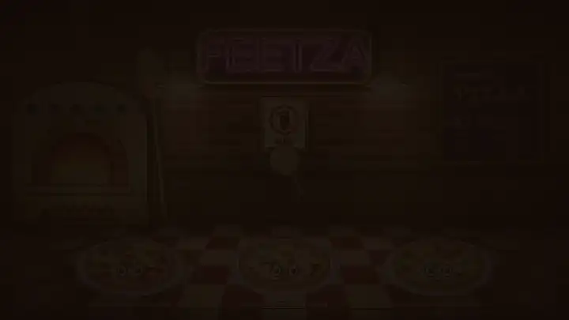

# 🍕 Feetza

[](https://trongateslegacy.github.io/feetza-the-game/trailer.mp4)

**Stop the feet. Save the pizza.** A browser arcade roguelike: cartoon feet descend on a table of pizzas and you smack them away with a pizza peel before they stomp. Build a run from priced toppings and pizzas, travel a 60-wave journey through 12 stages, beat 24 bosses, and spend Golden Crusts on permanent upgrades between runs.

**Play it: https://trongateslegacy.github.io/feetza-the-game/**

**▶ Watch the 30s trailer with sound: https://trongateslegacy.github.io/feetza-the-game/trailer.mp4**

- **A 60-wave journey**: 12 stages, each a location (waves 1–4) plus its boss's own arena (wave 5). Act 1 ends at wave 30, the finale is at wave 60, then endless mode
- **24 bosses**: 12 main bosses and 12 mini-bosses (wave 3 of every stage), each with a signature move from the start. Bosses change phase at 66% and 33% health (mini-bosses at 50%): they rear up, glow amber then red, and switch moves. A banner names each move with what it does and how to answer it, the line under the boss bar keeps the answer on screen, and every move has a wind-up you can read before it lands
- **92 feet**, each with its own art, stats and traits, shown as icons on the foot and explained on a NEW FOOT card the first time it appears
- **56 pizzas**, each granting a perk while it survives. Pizzas go stale after about 10 waves; reheat them or swap in fresh ones
- **Five heat levels** (Mild to Inferno). Harder heats pay more Golden Crusts
- **Between-wave shop**: toppings cost tips (permanent, once-per-run and one-use kinds), a pizza counter with a swap picker, heal, rebake and reheat services, and a Golden menu paid from banked crusts
- **Wave events**: tip balloons, delivery drones, pepper moths, golden seagulls and pizza box chests (watch out for mimics)
- **9 permanent Pizzeria upgrades** (resettable for a full refund) and 53 unlockable pizzas
- **Run saves**: close the tab and continue from the shop; Act 2 starts unlock once you beat wave 30
- **Controller support** with free aim or lane mode, button prompts for Xbox, PlayStation and Switch, and full menu navigation
- **Accessibility**: colour-blind palettes, reduced motion, trait icons, screen shake and flash toggles
- **Pizzapedia** of every foot, boss, pizza and event, with how to beat each foot

All art (feet, pizzas, toppings, backdrops, UI sprites) is drawn procedurally with Canvas 2D at load time, so there are no image assets to download and everything stays sharp at any resolution.

## Controls

| Action | Mouse / touch | Keyboard |
|---|---|---|
| Smack a foot | Click / tap it | — |
| Peel Slam (screen-wide smack when charged) | Tap the SLAM button | `Space` |
| Pause | Pause button | `Esc` / `P` |
| Mute | Speaker button | `M` |
| Buy a topping / reroll / next wave | Click a card / Reroll / Next wave | `1`–`4` / `R` / `Enter` |

On a controller: left stick aims (or pick a pizza in lane mode), A or RT smacks, X or LT Peel Slams, Menu pauses; in menus the d-pad moves, A selects, B goes back and the bumpers jump between shop sections.

## Play / develop

```bash
npm install
npm run dev      # http://localhost:5173
npm run build    # typecheck + production build into dist/
npm run preview  # serve the production build
```

Requires Node 20+.

## Hosting

Every push to `main` deploys to GitHub Pages (served from the `gh-pages` branch) through `.github/workflows/pages.yml`. Every pull request gets its own playable preview at `https://trongateslegacy.github.io/feetza-the-game/pr-preview/pr-<number>/` through `.github/workflows/pr-preview.yml`; the preview is removed when the pull request closes.

`dist/` is a plain static folder with relative paths, so it can also go anywhere else:

- **Netlify**: `netlify.toml` is already set up (build `npm run build`, publish `dist`, plus long-cache headers for assets and audio, which GitHub Pages can't set). Import the repo in Netlify, or run `npx netlify-cli deploy --build --prod`.
- **itch.io**: zip the *contents* of `dist/`, upload it as an HTML game, and tick "Mobile friendly".
- **Vercel / Cloudflare Pages**: build command `npm run build`, publish directory `dist`.

## Stack choice

| Option | Verdict |
|---|---|
| **Phaser 3.90 + Vite + TypeScript** ✅ | Mature 2D engine: WebGL batching, particles, tweens, cameras, a Web Audio sound manager, scale manager. Vite gives instant dev reloads and an optimised static build that suits Netlify. 3.90 is the final, battle-tested v3 release. |
| Phaser 4 | Newer renderer, but a younger API with breaking changes. No benefit for a 2D sprite game. |
| PixiJS + Howler | Great renderer, but you'd hand-roll scenes, tweens, input and audio categories. |
| Three.js / Babylon | 3D engines, overkill for a 2D arcade game. |
| React/Canvas from scratch | Maximum control, but slower to reach this level of polish. |

UI (HUD, menus, upgrade cards, settings) is a DOM overlay scaled with CSS container-query units, which gives crisp text, real range sliders and accessibility for free while Phaser renders the game.

## Project layout

```
src/
  art/        procedural Canvas2D art: feet, pizzas, toppings, backdrops, sprites
  data/       feet, pizzas, upgrades, meta upgrades (all the content tables)
  game/       Foot, Pizza, Run (stats + wave planning), Fx, BackdropView, assets
  scenes/     Boot (generation + loading), Menu, Game
  systems/    audio (category volumes, crossfades, lazy loading), save (localStorage)
  ui/         DOM overlay: HUD, menus, modals
public/audio/ music, ambience and SFX (+ CREDITS.md / credits.json)
```

## Dev tools

`npm run dev` exposes a `F` helper in the browser console (development builds only):

- `F.contrast()` audits every visible piece of overlay text for WCAG contrast (4.5:1, or 3:1 for large text). It reads the real background behind each element, including every gradient stop, and flags text drawn over the game without an outline. Run it on each screen after UI changes.
- `F.trailer()` renders the trailer: it steps the real game frame by frame at 60 fps on a virtual clock (with a scripted shot list in `src/trailer.ts`), uploads each frame, and logs every sound effect with its frame time. The soundtrack is then mixed in sync with ffmpeg. Start the dev server with `FEETZA_SHOT_DIR=<dir>` to receive the frames. Nothing plays through the speakers while it renders. `F.trailer('v_', true)` renders the 9:16 portrait cut for Reels, Shorts and TikTok instead: the game renders at 2×, and each frame is composited into 1080×1920, cutting between the whole table and full-screen close-ups.
- `F.bot(true, accuracy, reactionMs)` plays the game automatically (useful for balance checks), and `F.shot(name)` saves a canvas screenshot when the server is started with `FEETZA_SHOT_DIR`.

## Audio mix

- Music and ambience are loudness-normalised to about -16 LUFS. Ambience is mixed about 8 dB under music.
- SFX gains are calibrated from measured 50 ms RMS peaks so slaps, crits, stomps and UI sounds sit at deliberate relative levels (see `TRIM` in `src/systems/audio.ts`). Slaps round-robin through three recordings with pitch variation.
- Loops are made gapless at runtime by trimming MP3 encoder padding from the decoded buffer.
- Larger tracks stream in lazily, and the next location's and boss's tracks are preloaded one wave ahead.

## Credits

Music by Kevin MacLeod (incompetech.com), licensed CC-BY 4.0. SFX and ambiences are CC0 from Kenney.nl and Freesound contributors. Full per-file credits are in [`public/audio/CREDITS.md`](public/audio/CREDITS.md) and in-game under **Credits**. Fonts: Lilita One and Fredoka (SIL OFL).

## Dev tools

In `npm run dev`, the browser console has `F`:

- `F.startGame({ heat: 'hot', wave: 23, coins: 400, upgrades: { heavy: 3 }, lineup: [...], intros: false })` starts from any point; `F.startGame({ boss: { id: 'kraken', hp: 0.5 } })` jumps straight to a boss at half health
- `F.seed(42)` makes the randomness repeatable; `F.saveScenario()` returns the current run as a scenario
- `F.bot(true)` plays and shops by itself, logging each wave to `F.log`
- `F.contrast()` lists any on-screen text below WCAG contrast
